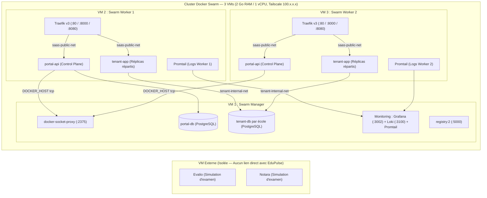

# README — EduPulse (Cloud Learning SaaS Multi-Tenant)

EduPulse est une plateforme SaaS multi-tenant en silo dédiée à la centralisation des traces d'apprentissage (xAPI), à l'évaluation analytique des résultats scolaires et à la détection précoce des élèves en difficulté. Ce document sert de référence d'architecture et de guide opérationnel pour les développeurs et les mainteneurs du projet.

> 📋 **Liste détaillée des fonctionnalités (User & Fonctionnel)** : voir [FONCTIONNALITES.md](FONCTIONNALITES.md).

---

## 1. Architecture Globale & Répartition sur les VMs

### 1.1 Topologie d'Infrastructure (3 VMs Swarm + 1 VM Externe)

La plateforme repose sur un cluster **Docker Swarm de 3 VMs** (calibrées à **2 Go RAM / 1 vCPU** chacune) interconnectées via un réseau privé **Tailscale** (`100.x.x.x`), complété par une **4ᵉ VM totalement indépendante** hébergeant des applications tierces de simulation d'examens (**Evalio** et **Notara**) :



**Répartition précise des rôles :**
* **1 VM Manager (`node.role == manager`)** :
  * Héberge les services critiques à état et d'orchestration : le **Registry Docker privé** (`registry:2` sur le port `5000`), le **Docker Socket Proxy** (`tecnativa/docker-socket-proxy` exposant l'API Swarm aux Workers de façon sécurisée), la base **`portal-db`**, et toutes les bases **`tenant-db`** des établissements (ancrées sur le Manager pour garantir la persistance des volumes PostgreSQL).
  * Héberge la stack d'observabilité **Grafana + Loki + Promtail** pour centraliser les journaux du Manager et des Workers.
* **2 VMs Workers (`node.role == worker`)** :
  * Hébergent **Traefik v3** en mode `global` (1 instance par Worker, ports `80`, `8000`, `8080`), le portail **`portal-api`** (2 réplicas répartis via `spread: node.id`) et tous les conteneurs applicatifs **`tenant-app`** des écoles.
  * Un agent **Promtail** tourne sur chaque Worker pour expédier les logs Docker vers Loki sur le Manager.
* **1 VM Externe séparée (`external-apps/`)** :
  * Héberge **Evalio** et **Notara** (applications de simulation d'examens). Elles n'ont **aucun lien réseau ou applicatif direct** avec EduPulse et servent à simuler des plateformes pédagogiques externes.

### 1.2 Modèle Multi-Tenant en Silo (2 Plans)

L'application est divisée en deux plans séparés qui communiquent via l'API Docker Swarm (`docker-socket-proxy`) :

| Plan architectural | Dossier | Rôle et responsabilités | Base de données |
| :--- | :--- | :--- | :--- |
| **1. Control Plane (Portail SaaS Public & Super-Admin)** | `cloud-learning-saas/portal/` | Vitrine commerciale, inscription des administrateurs d'abonnement, choix du plan (200, 500 ou 1000 utilisateurs), supervision des ressources (`psutil`), configuration IA globale et orchestration Swarm des stacks clients. | Conteneur PostgreSQL dédié (`portal-db`) contenant `portal_users`, `tenant_stacks`, `portal_settings` et `cloud_events`. |
| **2. Data / App Plane (Stack Isolé par Établissement)** | `cloud-learning-saas/tenant-stack/` | Instance dédiée à une école regroupant un serveur FastAPI, un Learning Record Store (LRS) xAPI, l'analytique IA/PDF et 3 vues métiers (Étudiant, Enseignant, Admin d'école). | 1 conteneur `postgres:16-alpine` isolé par école (`<slug>_tenant-db`) avec tables SQL et stockage `JSONB`. |

### Mécanisme de provisionnement dynamique
Lorsqu'un client (`SUBSCRIPTION_ADMIN`) ou le `SUPER_ADMIN` crée un établissement depuis le portail (`POST /api/tenants` ou `POST /api/superadmin/tenants`), la fonction `orchestrate_tenant_stack()` de `portal/main.py` génère un fichier stack Swarm pré-interpolé et exécute :

`docker stack deploy --resolve-image=never -c /tmp/stack-<slug>.yml <slug>` (avec repli sur `docker compose` si Swarm est inactif).

Elle injecte dynamiquement les variables d'environnement propres au client :
* `TENANT_SLUG` : Identifiant réseau unique servant de sous-domaine et de préfixe de service (`<slug>_tenant-app` et `<slug>_tenant-db`).
* `INSTITUTION_NAME` : Nom officiel de l'établissement affiché sur l'interface. **Règle de peuplement :** si ce nom commence par « demo » ou « démo » (insensible à la casse), le stack s'initialise avec un jeu complet de données de démonstration (3 profs, 2 classes, 12 élèves, ~85 traces xAPI). Dans tous les autres cas, le conteneur arrive **entièrement vide** (seul le compte administrateur principal est créé).
* `MAX_USERS` : Quota strict de comptes autorisés dans la base SQL de l'établissement (`200`, `500` ou `1000`).
* `ADMIN_EMAIL`, `ADMIN_PASSWORD_HASH`, `ADMIN_FULL_NAME` : Identifiants du compte client sur le portail, utilisés au premier démarrage du stack pour créer automatiquement le compte Administrateur Principal de l'école avec le même mot de passe haché (Bcrypt).
* `GEMINI_API_KEY` & `GEMINI_MODEL` : Clé API Gemini (par défaut `gemini-3.5-flash-lite`) héritée du Manager/Super-Admin.
* `TENANT_PORT` : Port hôte de secours calculé selon la formule `8100 + tenant.id` (ex: `8101` pour le premier stack, `8102` pour le second).

### 1.3 Piliers Cloud (Scalability, Elasticity, Agility & Maintenance)
La plateforme supporte nativement **Docker Swarm** (`docker stack deploy`, `docker service scale`, `docker service update`) avec repli automatique sur Docker Compose si Swarm n'est pas initialisé :
* **Scalability (Scalabilité Horizontale & Verticale)** :
  * Chaque abonnement définit un quota d'utilisateurs, des limites CPU/RAM (`deploy.resources.limits`) et une plage de réplicas (`Plan 200` = 2 réplicas initiaux [1↔3], `Plan 500` = 2 réplicas [2↔5], `Plan 1000` = 3 réplicas [2↔8]).
  * Le Super-Admin peut augmenter ou réduire à chaud le nombre de réplicas de n'importe quel établissement (`POST /api/superadmin/tenants/{slug}/scale` → `docker service scale <slug>_tenant-app=<N>`), avec équilibrage de charge automatique par Traefik et le Swarm Ingress Routing Mesh.
* **Elasticity (Élasticité & Auto-Scaling Dynamique)** :
  * Le moteur d'auto-scaling (`evaluate_autoscale` dans `portal/main.py`) surveille la charge CPU/RAM du cluster :
    * **Scale-Out automatique** dès que `CPU >= 70%` (ou `RAM >= 85%`) jusqu'à `max_replicas`.
    * **Scale-In automatique** lorsque `CPU <= 30%` jusqu'à `min_replicas` pour libérer les ressources inutilisées.
  * Un simulateur de pic de charge (`POST /api/superadmin/autoscale/simulate-load`) est intégré au panneau Super-Admin pour démontrer l'auto-scaling en direct.
* **Agility (Agilité, Zero-Downtime Rolling Updates & Maintenance)** :
  * Le bouton **« 🔄 Rolling Update »** (`POST /api/superadmin/tenants/{slug}/rolling-update`) et le bouton **« 🔄 Rolling Update Global (Tous) »** (`POST /api/superadmin/tenants/rolling-update-all`) mettent à jour les réplicas un par un avec la politique `start-first` sans coupure de service.
  * Le **Mode Maintenance** (unitaire `POST /api/superadmin/tenants/{slug}/maintenance` ou global `POST /api/superadmin/tenants/maintenance-all`) permet de couper proprement l'accès utilisateur (`HTTP 503` + écran de maintenance) pendant une intervention critique.

---

## 2. Arborescence du Projet

```text
V2/
├── Doc/
│   ├── README.md                           # Architecture globale et guide opérationnel
│   ├── FONCTIONNALITES.md                  # Liste simple des fonctionnalités (User & Fonctionnel)
│   └── architecture_et_plan_du_projet_saas.md
├── cloud-learning-saas/
│   ├── docker-compose.yml                  # Socle Swarm : Registry + Socket-Proxy + Portal-DB + Traefik + Portal-API
│   ├── deploy-swarm.sh                     # Script de build, push Registry et déploiement Swarm
│   ├── portal/                             # CONTROL PLANE (Site d'accueil & Super-Admin)
│   │   ├── Dockerfile
│   │   ├── requirements.txt
│   │   ├── main.py                         # API REST du portail, auth JWT, config IA, monitoring & orchestration Swarm
│   │   └── static/index.html               # Interface web (Vitrine, Espace Client, Super-Admin)
│   └── tenant-stack/                       # DATA/APP PLANE (Modèle de stack isolé par établissement)
│       ├── docker-compose.tenant.yml       # Template Swarm/Compose instancié par école (<slug>)
│       ├── Dockerfile
│       ├── requirements.txt
│       ├── demo_data.py                    # Jeu de données de démonstration (profs, classes, élèves, traces xAPI)
│       ├── main.py                         # API École : Quota, LRS xAPI, Analytique, IA anonymisée, Rapports PDF
│       └── static/index.html               # Interface web de l'école (Vues Étudiant, Enseignant, Admin École)
├── monitoring/                             # Stack d'observabilité centralisée
│   ├── docker-compose.yml                  # Déploiement local (Loki + Promtail + Grafana)
│   ├── docker-compose.swarm.yml            # Déploiement Swarm (Manager + Workers)
│   ├── deploy-monitoring-swarm.sh          # Script de déploiement monitoring Swarm
│   ├── loki-config.yml
│   ├── promtail-config.yml
│   └── grafana/
└── external-apps/                          # VM externe séparée (simulation d'apps tierces)
    ├── evalio/
    └── notara/
```

---

## 3. Routage Réseau, DNS & Ports d'Accès

Le projet centralise le trafic HTTP public via **Traefik** qui écoute directement sur le **port HTTP standard `80`** (`80:8000`) ainsi que sur le port `8000` (`8000:8000`) pour la rétrocompatibilité locale. Chaque stack d'établissement est ainsi accessible **directement par son sous-domaine sans numéro de port dans l'URL**, tout en conservant un port direct de secours (`8100 + id`) :

* **Configuration DNS Officielle (Sans port dans l'URL) :**
  * **Domaine principal (`http://edupulse.mnbll.fr`)** : Pointe vers l'IP publique du serveur/VPS (port 80). Traefik route automatiquement vers le portail d'accueil public et le panneau Super-Admin (`portal-api:8000` sur le réseau interne `saas-public-net`).
  * **Wildcard (`http://<slug>.edupulse.mnbll.fr`)** : Pointe vers la même IP publique du serveur/VPS (port 80). Traefik intercepte le sous-domaine `<slug>.edupulse.mnbll.fr` sur le port 80 et redirige le trafic en interne sur le réseau overlay `saas-public-net` vers le service `<slug>_tenant-app:8000`, **sans jamais afficher ni utiliser le port dans l'URL**.
* **Protection contre l'interception Proxy sur Traefik :**
  * Sur les VMs universitaires (UPPA), le conteneur `traefik` force explicitement `HTTP_PROXY=""`, `HTTPS_PROXY=""` et `NO_PROXY="*"` afin que la configuration `~/.docker/config.json` n'envoie jamais le trafic interne des conteneurs Docker vers le proxy `cache.univ-pau.fr:3128`.
* **Résolution Dynamique des Redirections & Liens :**
  * Toutes les redirections et liens s'adaptent dynamiquement :
    * Sur le domaine de production (`edupulse.mnbll.fr`) -> URL pure par sous-domaine `http://<slug>.edupulse.mnbll.fr`, avec un lien secondaire de secours vers le port direct (`:8101`, `:8102`...).
    * En développement local (`localhost`) -> URL de sous-domaine local `http://<slug>.localhost` (ou `:8000`, ou port direct `:810X`).
    * Par IP directe -> URL sur port dédié `http://<IP>:${8100 + id}`.
* **Isolation réseau des bases de données :** Les conteneurs PostgreSQL (`<slug>_tenant-db`) sont uniquement rattachés à leur réseau interne (`tenant-internal-net`) sans port exposé sur l'hôte, tandis que les conteneurs applicatifs (`<slug>_tenant-app`) sont connectés à la fois à `saas-public-net` (pour Traefik) et à `tenant-internal-net`.

---

## 4. Schéma des Bases de Données & LRS xAPI

### A. Base SQL du Portail (`portal-db` — `portal/main.py`)
* **`portal_users`** : Stocke les utilisateurs du portail (`id`, `email`, `full_name`, `password_hash`, `role` valant `SUPER_ADMIN` ou `SUBSCRIPTION_ADMIN`, `created_at`).
* **`tenant_stacks`** : Référence les stacks déployés (`id`, `institution_name`, `slug`, `domain`, `plan_max_users`, `status`, `replicas`, `min_replicas`, `max_replicas`, `autoscale_enabled`, `orchestrator`, `maintenance_mode`, `owner_id`, `created_at`).
* **`portal_settings`** & **`cloud_events`** : Paramètres globaux persistés (`gemini_api_key`, `gemini_model`) et journal des événements d'orchestration (`AUTOSCALE`, `AGILITY`, `SWARM`).

### B. Base SQL d'un Établissement (`<slug>_tenant-db` — `tenant-stack/main.py`)
* **`users`** : Utilisateurs internes à l'établissement (`id`, `email`, `full_name`, `password_hash`, `role` valant `ADMIN`, `ENSEIGNANT` ou `ETUDIANT`, `class_name`, `created_at`). Avant chaque création (`POST /api/admin/users`), l'API vérifie que le nombre total de comptes est strictement inférieur à `MAX_USERS`.
* **`xapi_statements` (Brique LRS xAPI)** :
  * Lorsqu'un étudiant saisit une note (acceptant **2 décimales de `.01` à `.99`**, `step="0.01"`), le frontend construit un Statement xAPI conforme au standard ADL (`actor`, `verb`, `object`, `result`, `context`) et l'envoie à `POST /xapi/statements`.
  * Le statement complet est stocké nativement au format `JSONB` de PostgreSQL dans `statement_json`, accompagné des colonnes relationnelles `statement_uuid`, `student_id`, `course_name`, `verb`, `score_raw`, `score_max`, `score_scaled` et `timestamp`.
* **`student_alerts` (Indicateurs statistiques, Conseils IA & Appréciation Enseignant)** :
  * Table mise à jour après chaque insertion xAPI via `recompute_student_analytics(db, student_id)` (`average_score`, `recent_trend`, `weakest_course`, `risk_level` : `CRITIQUE`, `VIGILANCE`, `STABLE`, `estimated_future_score`, `ai_coaching`, `teacher_appreciation`).
* **`class_ai_reviews`** & **`tenant_settings`** : Stockage des bilans IA globaux par classe et de l'état de maintenance administratif (`maintenance_mode`, `maintenance_message`).

---

## 5. Comptes par Défaut, Provisionnement Vierge & Mode Démonstration (⚙️)

Le portail d'accueil et chaque stack d'établissement intègrent un bouton de paramètres (`⚙️`) en haut à droite permettant de basculer instantanément entre les rôles.

### Niveau 1 — Portail d'Accueil (`portal/`)
* **Super-Admin Global (`SUPER_ADMIN`)** : Email `superadmin@edupulse.mnbll.fr` / Mot de passe `SuperSecretPassword123!` (auto-initialisé au démarrage de `portal-api`).
* **Client Démo (`SUBSCRIPTION_ADMIN`)** : Email `direction@lycee-moulin.fr` / Mot de passe `ClientPass123!` (créé ou connecté automatiquement via le menu `⚙️`).

### Niveau 2 — À l'intérieur de chaque Stack Établissement (`tenant-stack/`)
* **Établissement Standard (Nom ne commençant pas par `demo`)** : Arrive **100% vierge** avec uniquement le compte `ADMIN` du créateur.
* **Établissement de Démonstration (Nom commençant par `demo` ou `démo`)** : Pré-rempli automatiquement depuis `tenant-stack/demo_data.py` avec 3 enseignants (`Demo123!`), 2 classes (`M1 Cloud & DevOps`, `L3 Informatique`), 12 étudiants (`Demo123!`) et ~85 statements xAPI étalés sur 4 à 5 mois.

---

## 6. Monitoring des logs (Loki + Grafana + Promtail)

Stack dédiée dans `monitoring/` : **Promtail** collecte les logs des conteneurs Docker sur le **Manager** et sur chaque **Worker**, **Loki** les centralise, **Grafana** les visualise.

* **En mode Docker Swarm (3 VMs)** :
  ```bash
  cd monitoring
  ./deploy-monitoring-swarm.sh
  ```
  *(Déploie `monitoring/docker-compose.swarm.yml` : Loki + Grafana sur le Manager, Promtail en mode `global` sur tous les nœuds).*
* **En local (Docker Compose)** :
  ```bash
  cd monitoring
  docker compose up -d
  ```

| Service | URL | Accès |
|---------|-----|--------|
| Grafana | `http://<IP-Manager>:3002` (ou `http://localhost:3002`) | `admin` / `admin` |
| Loki API | `http://<IP-Manager>:3100` (ou `http://localhost:3100`) | — |

Dashboard provisionné : **EduPulse — Logs globaux**. Requêtes LogQL utiles : `{job="docker"}`, `{compose_project="evalio"}`, `{compose_project=~"edupulse.*"}`, `{job="docker"} |= "error"`.

---

## 7. Consignes Techniques pour la Maintenance (IA & Développeurs)

* **Réseau externe `saas-public-net`** : Ne jamais supprimer ce réseau externe dans `tenant-stack/docker-compose.tenant.yml`, car il permet à Traefik de router les requêtes vers chaque conteneur `<slug>_tenant-app`.
* **Syntaxe Traefik** : Conserver la règle `Host(`${TENANT_SLUG}.${BASE_DOMAIN:-edupulse.mnbll.fr}`) || Host(`${TENANT_SLUG}.localhost`)` sur le port interne `8000`.
* **Routes API du Portail (`portal/main.py`)** :
  * Authentification : `POST /api/auth/register`, `POST /api/auth/login`.
  * Espace Client : `GET /api/tenants/me` (et `/api/tenants/my`), `POST /api/tenants`, `POST /api/tenants/{slug}/change-plan`.
  * Super-Admin : `GET /api/superadmin/vm-stats`, `GET /api/superadmin/tenants`, `POST /api/superadmin/tenants`, `POST /api/superadmin/tenants/{slug}/scale`, `POST /api/superadmin/tenants/{slug}/autoscale-toggle`, `POST /api/superadmin/tenants/{slug}/rolling-update`, `POST /api/superadmin/tenants/rolling-update-all`, `POST /api/superadmin/tenants/{slug}/maintenance`, `POST /api/superadmin/tenants/maintenance-all`, `POST /api/superadmin/tenants/{slug}/{action}`, `DELETE /api/superadmin/tenants/{slug}`, `GET /api/superadmin/users`, `DELETE /api/superadmin/users/{user_id}`, `GET /api/superadmin/ai-config`, `POST /api/superadmin/ai-config`, `POST /api/superadmin/ai-config/sync-workers`, `POST /api/superadmin/autoscale/simulate-load`.
* **Routes API d'un Stack Établissement (`tenant-stack/main.py`)** :
  * Informations, Maintenance & Auth : `GET /api/info`, `POST /api/internal/maintenance`, `POST /api/auth/login`, `POST /api/auth/demo-switch/{target_role}`.
  * Admin École : `GET /api/admin/users`, `POST /api/admin/users`, `DELETE /api/admin/users/{user_id}`, `POST /api/admin/users/import-csv`, `GET /api/admin/users/csv-template`.
  * Étudiant & LRS xAPI : `POST /xapi/statements`, `GET /api/student/me`.
  * Enseignant : `GET /api/teacher/analytics`, `GET /api/teacher/chart-data`, `POST /api/teacher/ai-coaching/all`, `POST /api/teacher/ai-coaching/{student_id}`, `POST /api/teacher/ai-class-review`, `POST /api/teacher/class-report`, `POST /api/teacher/appreciation/{student_id}`.
