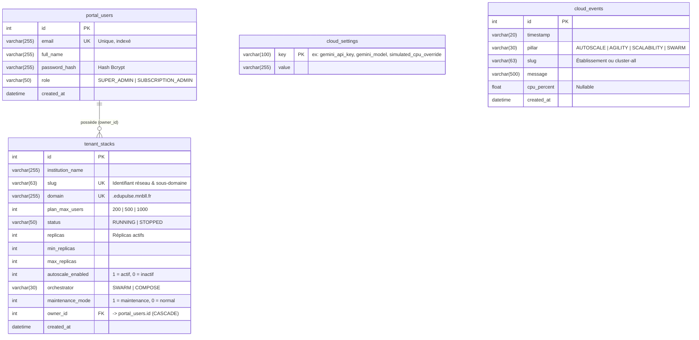
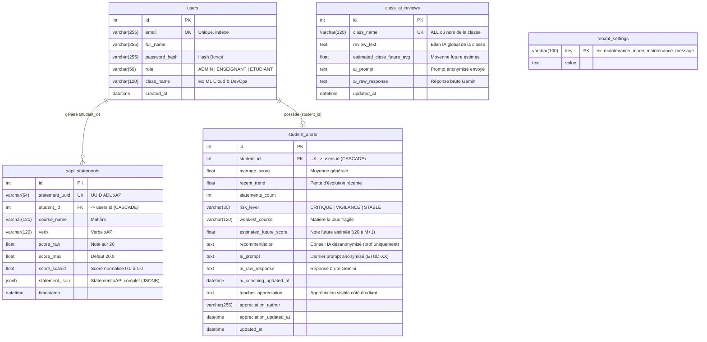

# Schéma des Bases de Données — EduPulse (Multi-Tenant en Silo)

EduPulse repose sur une architecture **PostgreSQL 16 Alpine** à **deux niveaux strictement isolés** :
1. **Base du Control Plane (`portal-db`)** : unique pour tout le SaaS, elle gère les comptes du portail, le registre des établissements, les réglages globaux et le journal d'orchestration Swarm.
2. **Bases du Data Plane (`<slug>_tenant-db`)** : **une base PostgreSQL dédiée, avec son propre conteneur, son propre volume (`<slug>_tenant_db_data`) et son propre réseau interne (`<slug>_tenant-internal-net`) pour chaque établissement**. Aucune donnée pédagogique n'est partagée entre deux écoles.

---

## 1. Base du Control Plane (`portal-db`)

Définie dans [portal/main.py](file:///c:/Users/yoan/OneDrive/Documents/MASTER/Cloud%20computing/V2/cloud-learning-saas/portal/main.py#L77-L132).

### Rôle de chaque table (`portal-db`)
* **`portal_users`** : Stocke les comptes d'accès au portail (clients `SUBSCRIPTION_ADMIN` et opérateur `SUPER_ADMIN`). Le `password_hash` Bcrypt du client créateur est transmis au stack de son école pour initialiser son compte `ADMIN` local avec le même mot de passe.
* **`tenant_stacks`** : Registre de toutes les écoles provisionnées (forfait, bornes de réplicas, état `RUNNING`/`STOPPED`, mode maintenance, et lien vers le propriétaire).
* **`cloud_settings`** : Stockage clé/valeur partagé entre tous les réplicas `portal-api` (clé API Gemini, modèle IA actif, override de simulation CPU).
* **`cloud_events`** : Journal d'audit des opérations Cloud (création, scaling, auto-scaling, rolling updates, maintenance).

---

## 2. Base Isolée par Établissement (`<slug>_tenant-db`)

Définie dans [tenant-stack/main.py](file:///c:/Users/yoan/OneDrive/Documents/MASTER/Cloud%20computing/V2/cloud-learning-saas/tenant-stack/main.py#L55-L128). Chaque établissement possède sa propre copie indépendante de ces 5 tables.

### Rôle de chaque table (`<slug>_tenant-db`)
* **`users`** : Annuaire interne de l'école. Avant toute insertion (création manuelle ou import CSV), l'API vérifie strictement `COUNT(users) < MAX_USERS`.
* **`xapi_statements`** : Learning Record Store (LRS) hybride. Conserve à la fois les colonnes relationnelles indexées pour des requêtes rapides (`student_id`, `course_name`, `score_raw`, `timestamp`) et le document JSON complet au standard ADL xAPI dans la colonne **`statement_json` (`JSONB`)**.
* **`student_alerts`** : Synthèse analytique et IA par étudiant (`1-to-1` avec `users`).
  * **Séparation des visibilités & traçabilité IA** :
    * `ai_prompt` garde la trace du prompt **anonymisé** (`ETUD-01`...) envoyé à Gemini.
    * `recommendation` et `estimated_future_score` stockent le coaching IA **désanonymisé** et la prévision M+1, **strictement réservés à la vue Enseignant** et aux rapports PDF.
    * `teacher_appreciation` stocke le message rédigé manuellement par l'enseignant, seul retour affiché dans la vue Étudiant.
* **`class_ai_reviews`** : Mémorise le dernier bilan IA global généré pour chaque classe (ou `"ALL"`), réutilisé dans l'interface professeur et dans l'assemblage des rapports PDF de classe.
* **`tenant_settings`** : Stocke les paramètres persistés de l'école, notamment l'état et le message du mode maintenance (`maintenance_mode`, `maintenance_message`), partagés entre tous les réplicas `tenant-app` de l'établissement.
